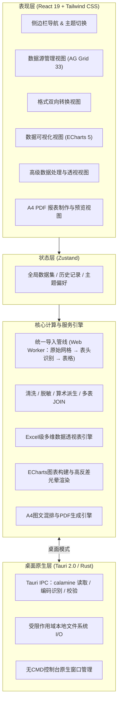

# 📊 表匠（Tablesmith）— 桌面数据转换、清洗分析与可视化工作台

> 产品规格与演进规划方案（Product Plan）v2.0  
> 状态：核心功能与架构已全量代码落地，进入体验打磨与持续演进阶段

---

## 一、 产品定位与核心设计原则

表匠是一款面向 **数据分析师、业务运营、研发人员及中小团队** 的轻量级、跨平台桌面报表与数据处理工作台（完美支持 macOS 与 Windows）。

系统致力于解决企业日常工作中数据流转与分析的四大核心痛点：**多格式转换繁琐**、**超大报表分析卡顿**、**可视化制作成本高** 以及 **敏感数据泄漏风险**。

### 核心设计原则：

1. **本地优先与零隐私泄漏（Local-First & Zero-Leakage）**：
   - 所有的文件解析、清洗、计算、透视与图表渲染默认 100% 在用户本地设备完成。
   - 绝不静默上传源文件、用户行级数据或任何业务信息至任何云端服务器。
2. **零成本构建与极速分发（Zero Cost & Frictionless Distribution）**：
   - **完全免除每年 \$99 的 Apple Developer 账号费用**，macOS 端采用高质量免费 Ad-hoc 签名与 DMG 打包。
   - 深度集成 GitHub Actions 云端多平台 CI/CD 自动化构建流水线，一键自动编译发布 macOS `.dmg` 与 Windows 免安装便携版 / NSIS `.exe` 安装包。
3. **只做桌面端（Desktop Only）**：
   - 产品形态只有 Tauri 2.0 桌面应用，不维护浏览器版本；前端代码直接调用 Tauri API，不做运行环境判断与浏览器降级。
   - 先在 Windows 上完成开发与验证，macOS 版本由 GitHub Actions 打包后再在 Mac 上验证。
4. **macOS HIG 极简美学与 100% 全局暗黑模式（Aesthetics & Accessibility）**：
   - 采用精致高质感的 macOS 苹果设计语言与 Slate/Zinc 专业中性色调。
   - 具备完整、彻底的 **浅色（Light）/ 深色（Dark）/ 跟随系统（System）** 三态持久化切换，严禁深色模式下存在局部白色刺眼色块。
   - 针对狭窄容器（如 `< 180px` 侧边栏底栏）采用极简 Icon 胶囊分段控制器（`[ ☀️ | 🌙 | 💻 ]`），杜绝中文单字竖向折行。
5. **大厂级前端视觉与自动化浏览器验收标准（Shift-Left & Zero-Assumption）**：
   - 严格遵循阿里 Ant Design、字节跳动 Semi Design 与腾讯 TDesign 的工业级工程标准。
   - 交付必须在真实 release exe 上完成自动化走查（Puppeteer 通过 WebView2 调试端口连接）与像素级自检，杜绝把半成品或审美缺陷留给用户。

---

## 二、 核心功能模块与工程代码落地对照

截至当前版本，表匠已完成全部五大核心业务模块与自动化质量保障工程的全面落地：

### 功能全景与代码落地对照表：

| 功能模块 | 核心能力规划 | 实际落地代码文件 | 落地状态 |
| :--- | :--- | :--- | :--- |
| **桌面架构与窗口** | Tauri 2.0 跨平台底层架构，无 CMD 黑框控制台启动（`#![windows_subsystem = "windows"]`），窗口尺寸与状态持久化 | [`src-tauri/src/main.rs`](file:///d:/code/zhanglx-index/disktopApp/tablesmith/src-tauri/src/main.rs) [`tauri.conf.json`](file:///d:/code/zhanglx-index/disktopApp/tablesmith/src-tauri/tauri.conf.json) | ✅ 100% 落地 |
| **模块 1：数据源管理** | Excel（xlsx/xlsm/xlsb/xls/ods，多级表头/合并单元格/一表多块）、CSV/TSV（多分隔符/多编码）、**XSD（5 大全景工作表）**、XML、JSON/JSONL（嵌套展开）、YAML 多文件拖拽或选择导入，桌面端与浏览器端结果一致；导入失败与跳过内容逐条提示；从剪贴板一键粘贴表格；文件只读保护；**未关闭数据源无缝持久化与恢复（IndexedDB）**；显式标签页关闭（`X`）与历史记录一键重开 | [`fileService.ts`](file:///d:/code/zhanglx-index/disktopApp/tablesmith/src/services/fileService.ts) [`storageService.ts`](file:///d:/code/zhanglx-index/disktopApp/tablesmith/src/services/storageService.ts) [`services/import/`](file:///d:/code/zhanglx-index/disktopApp/tablesmith/src/services/import/index.ts) [`import.rs`](file:///d:/code/zhanglx-index/disktopApp/tablesmith/src-tauri/src/import.rs) [`useFileImport.ts`](file:///d:/code/zhanglx-index/disktopApp/tablesmith/src/hooks/useFileImport.ts) [`FileDropZone.tsx`](file:///d:/code/zhanglx-index/disktopApp/tablesmith/src/components/FileDropZone.tsx) [`DataSourceView.tsx`](file:///d:/code/zhanglx-index/disktopApp/tablesmith/src/views/DataSourceView.tsx) | ✅ 100% 落地 |
| **模块 1：历史记录持久化** | 本地 localStorage 存储最近打开文件元数据，IndexedDB 深度缓存文件内容，支持历史记录快捷点击重开与一键清空 | [`useDataStore.ts`](file:///d:/code/zhanglx-index/disktopApp/tablesmith/src/store/useDataStore.ts) [`storageService.ts`](file:///d:/code/zhanglx-index/disktopApp/tablesmith/src/services/storageService.ts) [`Sidebar.tsx`](file:///d:/code/zhanglx-index/disktopApp/tablesmith/src/components/Sidebar.tsx) | ✅ 100% 落地 |
| **模块 1：大数据网格预览** | AG Grid 33 高性能网格，支持千万行级虚拟滚动、列排序、多列筛选、**全格网垂直分割线**、**单元格与字体多维缩放（70%~160% / 紧凑/标准/宽松三态预设）**、**全场景高对比度矢量 SVG 筛选按钮**、**筛选弹窗输入框文本防遮挡**、列宽自适应/平铺撑满、动态拖拽调整列宽、行列统计状态栏 | [`DataTable.tsx`](file:///d:/code/zhanglx-index/disktopApp/tablesmith/src/components/DataTable.tsx) [`index.css`](file:///d:/code/zhanglx-index/disktopApp/tablesmith/src/index.css) | ✅ 100% 落地 |
| **模块 2：双向格式转换** | 6 大格式双向无损转换（Excel/CSV/XML/JSON/YAML/SQL）；自定义 CSV 分隔符；SQL 表名与建表语句生成 | [`FormatConverter.tsx`](file:///d:/code/zhanglx-index/disktopApp/tablesmith/src/components/FormatConverter.tsx) [`ConvertView.tsx`](file:///d:/code/zhanglx-index/disktopApp/tablesmith/src/views/ConvertView.tsx) | ✅ 100% 落地 |
| **模块 3：专业图表可视化** | 折线图、柱状图、散点图、饼图、面积图；4 套大厂级配色方案（商务经典/科技霓虹/莫兰迪雅致/日落暖调）；堆叠模式；导出 2x 高清 PNG | [`chartService.ts`](file:///d:/code/zhanglx-index/disktopApp/tablesmith/src/services/chartService.ts) [`ChartPanel.tsx`](file:///d:/code/zhanglx-index/disktopApp/tablesmith/src/components/ChartPanel.tsx) [`ChartView.tsx`](file:///d:/code/zhanglx-index/disktopApp/tablesmith/src/views/ChartView.tsx) | ✅ 100% 落地 |
| **模块 3：图表高可读性标签** | 数值标签支持 WCAG AA 级对比度，3px 动态遮罩反差描边（暗色白字黑边，浅色黑字白边），杜绝标签被柱体或背景吞没 | [`chartService.ts`](file:///d:/code/zhanglx-index/disktopApp/tablesmith/src/services/chartService.ts) | ✅ 100% 落地 |
| **模块 4：基础清洗与加工** | 一键去重、一键清除空行、全局空白字符修剪（Trim）、自定义条件组合筛选（大于/小于/包含/等于）、排序列管理 | [`dataProcessService.ts`](file:///d:/code/zhanglx-index/disktopApp/tablesmith/src/services/dataProcessService.ts) [`ProcessView.tsx`](file:///d:/code/zhanglx-index/disktopApp/tablesmith/src/views/ProcessView.tsx) | ✅ 100% 落地 |
| **模块 4：计算列与字段加工** | 四则运算派生列（加减乘除任意两列）、多列文本拼接（自定义连接符）、指定列快速删除 | [`dataProcessService.ts`](file:///d:/code/zhanglx-index/disktopApp/tablesmith/src/services/dataProcessService.ts) [`ProcessView.tsx`](file:///d:/code/zhanglx-index/disktopApp/tablesmith/src/views/ProcessView.tsx) | ✅ 100% 落地 |
| **模块 4：Excel 级数据透视表** | 四象限多维透视架构（行分组/列交叉/值指标/切片器）；支持主次两级行维度；6 大聚合算法（求和/均值/计数/去重计数/最大/最小）；4 种值百分比显示（原始值存小数，显示为百分比）；行列总计汇总；双击数值下钻到源数据行（Excel“显示详细信息”），可另存为新工作表；结果与桌面 Excel 透视表逐格、明细逐行对照测试 | [`pivotTableService.ts`](file:///d:/code/zhanglx-index/disktopApp/tablesmith/src/services/pivotTableService.ts) [`ProcessView.tsx`](file:///d:/code/zhanglx-index/disktopApp/tablesmith/src/views/ProcessView.tsx) | ✅ 100% 落地 |
| **模块 4：敏感数据脱敏打码** | 手机号（前3后4保留）、身份证号（前6后4保留）、中文姓名（脱敏中间字）、电子邮箱（脱敏用户名）一键合规处理 | [`dataProcessService.ts`](file:///d:/code/zhanglx-index/disktopApp/tablesmith/src/services/dataProcessService.ts) [`ProcessView.tsx`](file:///d:/code/zhanglx-index/disktopApp/tablesmith/src/views/ProcessView.tsx) | ✅ 100% 落地 |
| **模块 4：多表关联与拼接** | 横向关联（Inner / Left / Right / Full JOIN 自定义主外键关联）；纵向拼接（Union 多表合并，列名自动对其） | [`dataProcessService.ts`](file:///d:/code/zhanglx-index/disktopApp/tablesmith/src/services/dataProcessService.ts) [`ProcessView.tsx`](file:///d:/code/zhanglx-index/disktopApp/tablesmith/src/views/ProcessView.tsx) | ✅ 100% 落地 |
| **模块 5：A4 图文混排报告导出** | A4 打印级实时预览；KPI 核心指标卡；动态嵌入 ECharts 可视化图表；自动生成数据摘要表格；结论分析文本；一键导出高清 PDF 与系统打印 | [`reportService.ts`](file:///d:/code/zhanglx-index/disktopApp/tablesmith/src/services/reportService.ts) [`ReportView.tsx`](file:///d:/code/zhanglx-index/disktopApp/tablesmith/src/views/ReportView.tsx) | ✅ 100% 落地 |
| **外观与体验：100% 纯粹暗黑模式** | 浅色/深色/跟随系统 3态持久化切换；AG Grid v33 CSS 变量穿透与深黑主题重构；侧边栏极简 Icon 胶囊控制器 | [`Sidebar.tsx`](file:///d:/code/zhanglx-index/disktopApp/tablesmith/src/components/Sidebar.tsx) [`index.css`](file:///d:/code/zhanglx-index/disktopApp/tablesmith/src/index.css) [`useDataStore.ts`](file:///d:/code/zhanglx-index/disktopApp/tablesmith/src/store/useDataStore.ts) | ✅ 100% 落地 |
| **交互体验：人体工学极速导出与历史路径记忆** | 首次导出自动感知定位真实系统下载目录；后续导出 100% 记忆上一次自定义导出目录；点击「直接保存导出」直接落盘，彻底消除系统二次「另存为」弹窗冗余；全局浮层通知支持一键在文件夹中显示定位 | [`ExportModal.tsx`](file:///d:/code/zhanglx-index/disktopApp/tablesmith/src/components/ExportModal.tsx) [`fileService.ts`](file:///d:/code/zhanglx-index/disktopApp/tablesmith/src/services/fileService.ts) [`GlobalToast.tsx`](file:///d:/code/zhanglx-index/disktopApp/tablesmith/src/components/GlobalToast.tsx) | ✅ 100% 落地 |
| **质量保障：桌面端视觉自动化走查** | 启动 release exe 并通过 WebView2 调试端口连接 Puppeteer，写入系统 PATH 的 `tablesmith-verify` 全局走查命令，10秒内生成 5 大核心场景截图自检闭环 | [`verify-ui.cjs`](file:///d:/code/zhanglx-index/disktopApp/tools/verify-ui.cjs) [`BROWSER_ACCEPTANCE_SPEC.md`](file:///d:/code/zhanglx-index/disktopApp/BROWSER_ACCEPTANCE_SPEC.md) | ✅ 100% 落地 |
| **品牌包装：高分辨率跨平台图标** | 科技感表匠品牌视觉，全套生成 macOS `.icns`（16~1024px）与 Windows `.ico`（16~256px）图标资源 | [`src-tauri/icons/icon.icns`](file:///d:/code/zhanglx-index/disktopApp/tablesmith/src-tauri/icons/icon.icns) [`src-tauri/icons/icon.ico`](file:///d:/code/zhanglx-index/disktopApp/tablesmith/src-tauri/icons/icon.ico) | ✅ 100% 落地 |
| **CI/CD：跨平台自动化打包流水线** | GitHub Actions 多平台矩阵自动化构建，自动产出 macOS 免开发者账号 Ad-hoc DMG 与 Windows 免安装便携版 / NSIS 安装包 | [`.github/workflows/release.yml`](file:///d:/code/zhanglx-index/disktopApp/.github/workflows/release.yml) | ✅ 100% 落地 |

---

## 三、 详细功能规格与深度交互设计

### 1. 模块 1：数据源管理（Data Ingestion）
* **支持格式**：
  * **XML 模式定义 (`.xsd`)**：全面支持 W3C XML Schema 文件结构化解析与元数据提取，自动拆解为 5 大全景工作表：
    1. `Elements (元素结构)`：元素名称、所属父节点、数据类型、最小出现次数（`minOccurs`）、最大出现次数（`maxOccurs`）；
    2. `Attributes (字段属性)`：属性名称、所属元素、数据类型、约束级别（`required` / `optional` / `prohibited`）、默认值或固定值；
    3. `SimpleTypes (枚举与类型)`：自定义简单类型名称、基础数据类型（`base`）、限制性枚举候选值列表；
    4. `Constraints (主外键约束)`：主键（`key`）、唯一键（`unique`）、外键参照（`keyref`）、目标 XPath 选择器与字段映射；
    5. `SchemaSummary (元信息)`：命名空间（`targetNamespace`）、元素限定规范（`elementFormDefault`）等元数据全览。
  * **Excel (`.xlsx`, `.xlsm`, `.xlsb`, `.xls`, `.ods`)**：桌面端由 Rust calamine 读取 xlsx/xlsm/xls，读不了的文件（以及 xlsb、ods）改用 SheetJS；两种读取方式都输出同一种原始单元格网格（文本 / 数值 / 布尔 / 日期 / 错误值 + 合并区域 + 隐藏状态），再由同一个规整器生成表格。规整规则：
    1. 跳过报表大标题、空行；在前 12 个非空行里找第一行“填充度不低于最宽行 60%、只含文字 / 日期 / 年份且至少一个文字”的行作为表头；在表头之前先遇到满行数字时按无表头处理（列名 `列A`、`列B`…）；
    2. 表头下一行也是文字行、且有合并单元格证据时视为多级表头，拼接为 `上半年 / Q1`；纵向合并的单元格向下填充（如地区列）；
    3. 同一工作表中“空行 + 小标题 + 新表头”或“两个以上空行 + 新表头 + 数据”处拆成独立工作表，命名为 `原表名 · 小标题`；表头上方的说明行、表尾横跨半宽以上的单格备注不进入数据，并在导入提示中列出；
    4. 数值保留原值（15 位有效数字，不套用货币 / 千分位显示格式）；日期类单元格输出 `YYYY-MM-DD`、`HH:MM:SS` 或 `YYYY-MM-DD HH:MM:SS`，月初日期作表头时显示 `YYYY-MM`；错误值显示为 `#DIV/0!` 等；
    5. 公式读取缓存结果；没有缓存结果的公式统计个数并提示“在 Excel 中打开保存一次后重新导入”；公式文本随单元格导入（xlsx 由 Rust 读取，xls / xlsb 由 SheetJS 读取），在表格中以角标、悬停和公式栏查看，不重算、不改变值；隐藏工作表导入并提示，空白工作表跳过并提示；
    6. 重复列名编号为 `金额_2`，全空列去除，字符串原样保留（前导零、前导空格表示的层级缩进不丢失）；加密工作簿给出“取消密码后再导入”的提示。
  * **CSV / TSV / TXT**：编码按 BOM → UTF-16 无 BOM 嗅探 → 严格 UTF-8 → GB18030 顺序识别，非 UTF-8 时提示实际编码；分隔符在逗号、Tab、分号、竖线中自动识别，引号内的分隔符与换行保持在单元格内，引号未闭合时提示行号；行长度不齐时补齐；表头识别规则与 Excel 相同。
  * **JSON / JSONL (`.json`, `.jsonl`, `.ndjson`)**：顶层数组直接成表（标量数组成为单列 `值`）；对象中找出深度 4 以内的每个对象数组各成一表，其余标量字段放入 `元信息` 表；嵌套对象展开为点号列名（`address.city`，深度 4 以内），标量数组以逗号连接，更深的结构保留为 JSON 文本；整份不是合法 JSON 但每行是 JSON 时按 JSON Lines 读取；语法错误提示行列位置。
  * **XML (`.xml`)**：先校验语法并提示错误行列；按元素出现顺序保留列顺序；重复出现的元素按标签各成一表（属性、叶子子元素、子元素属性 `Total@currency` 成为列，同名叶子以逗号合并）；嵌套记录携带父记录主键列（如 `Order.id`）；只出现一次的元素与根属性放入 `元信息` 表；去除命名空间前缀；按 XML 声明的编码解码；Excel 另存的 SpreadsheetML / HTML 表格按表格读取。
  * **YAML (`.yaml`, `.yml`)**：规则同 JSON；多文档 YAML（`---` 分隔）每个文档作为一行。
* **导入入口与反馈**：文件选择器多选、拖入窗口（Tauri 原生拖放事件按路径读取，拖动时整个数据源视图高亮）、剪贴板粘贴三种入口共用一个流程；解析在 Web Worker 中进行，切换页面时取消未完成的解析；单个文件失败不影响同批其他文件，失败原因以不自动消失的错误提示展示；有跳过内容或编码转换时弹出一行简短提示，详情记录在文件上，在表格上方“导入说明”中展开查看；单个文件上限 200 MB（Rust 与前端同时校验）。
* **剪贴板一键粘贴**：用户可直接从网页表格、WPS 或外部软件复制文本，点击主界面“从剪贴板直接粘贴表格”即可秒级转为结构化工作表。
* **输入保护**：所有读取操作均为只读；任何处理结果均以“另存为新文件”或“创建新工作表”方式输出，绝不覆盖篡改原始文件。

### 2. 模块 2：双向格式转换引擎（Format Converter）
* **转换矩阵**：
  $$\text{Excel} \longleftrightarrow \text{CSV} \longleftrightarrow \text{XML} \longleftrightarrow \text{JSON} \longleftrightarrow \text{YAML} \longrightarrow \text{SQL}$$
* **转换参数配置**：
  * 导出 CSV：支持自由切换 `,`（逗号）、`;`（分号）、`\t`（制表符）、`|`（竖线）分隔符。
  * 导出 SQL：支持自定义表名，自动生成 `CREATE TABLE` DDL 语句及批量 `INSERT INTO` DML 语句，数值与字符串自动加引号防护。
  * 导出 XML：自动包裹标准根节点 `<root>` 与行记录节点 `<record>`。

### 3. 模块 3：专业图表可视化（Data Visualization）
* **图表类型矩阵**：
  * 📈 **折线图 (Line)**：平滑曲线、支持多序列对比，适合时间维度趋势跟踪。
  * 📊 **柱状图 (Bar)**：支持并排对比与堆叠累加（Stack），直观反映分类规模。
  * 🥧 **饼图 (Pie)**：环形比例分布，自动计算各分类占比（%）。
  * 🔵 **散点图 (Scatter)**：展现两数值变量间的离散分布与相关性。
  * 📉 **面积图 (Area)**：带有 25% 柔和半透明填充的折线面积，凸显累积体量。
* **四套专业设计主题调色板**：
  * **商务经典 (Business)**：科技蓝、珊瑚红、翡翠绿、琥珀黄，严谨清晰。
  * **科技霓虹 (Tech)**：青色、靛青蓝、亮粉紫、荧光绿，现代酷炫。
  * **莫兰迪雅致 (Morandi)**：中性灰、深邃海蓝、复古松石绿、雅致赭石，高级克制。
  * **日落暖调 (Sunset)**：落日橙、朱砂红、姜黄、玫瑰红，热烈饱满。
* **数值标签高反差光晕描边（WCAG AA 级）**：
  * 开启“数值标签”后，无论选择哪种柱体颜色或背景模式，文字均外挂 3px 动态高反差光晕描边（暗色白字黑边、浅色黑字白边），保证文本 100% 清晰可读。
* **高清导出**：提供 2x 设备像素比（DPR=2）高清 PNG 一键导出。

### 4. 模块 4：高级数据处理与分析加工（Data Processing & Analytics）
* **数据清洗套件**：
  * 一键按指定列排重（保留首行）。
  * 一键剔除整行全空记录。
  * 一键修剪（Trim）所有单元格首尾冗余空格及特殊换行符。
* **复合条件筛选（Multi-condition Slicing）**：
  * 支持对数值字段执行 `>`、`>=`、`<`、`<=`、`=` 过滤；对文本字段执行“包含（contains）”过滤；并可一键重置恢复。
* **计算列派生**：
  * **四则运算列**：支持任意两列进行 $[+、-、\times、\div]$ 运算（如：`销售额 - 成本` 派生 `净利润`），除以 0 自动保护为 0。
  * **文本拼接列**：支持任意两列按指定连接符（如 `-`、`_` 或空字符）合并为新组合列。
* **敏感数据脱敏合规**：
  * 手机号脱敏：保留前3后4位，中间4位打码（`138****5678`）。
  * 身份证号脱敏：保留前6后4位，中间8位生日打码（`110101********1234`）。
  * 姓名脱敏：保留姓氏，名打码（如“张*丰”、“李*”）。
  * 邮箱脱敏：保留首字母与域名，用户名打码（`t***@domain.com`）。
* **多表横向关联 (JOIN) 与纵向拼接 (Union)**：
  * 关联（JOIN）：支持在两个工作表间按指定连接键执行 Inner JOIN、Left JOIN、Right JOIN、Full JOIN。
  * 拼接（Union）：支持将结构相同或相似的多个工作表垂直追加合并为单一长表。
* **Excel 级四象限多维数据透视表 (Pivot Table)**：
  * **行维度分组（Rows）**：支持主行维度分组，并可选次级行维度展开，形成多层级树状分析体系。
  * **列交叉对比（Columns）**：支持将离散分类字段（如月份、地区、产品线）横向展开为交叉对比列。
  * **值指标与聚合函数（Values）**：支持 6 大统计聚合：求和（SUM）、平均值（AVG）、计数（COUNT）、去重计数（DISTINCT COUNT）、最大值（MAX）、最小值（MIN）。
  * **值显示方式（Show Values As）**：支持 4 种计算口径切换：原始统计值、占总计百分比（% of Grand Total）、占行合计百分比（% of Row Total）、占列合计百分比（% of Col Total）。
  * **前置过滤与切片控制**：集成字段切片器与过滤规则，支持结果排序与一键切换行列总计汇总行。

### 5. 模块 5：A4 图文混排报表制作与导出（Report Publishing）
* **报表画布架构**：
  * 严格遵循国际标准 A4 纵向打印比例（$210\text{mm} \times 297\text{mm}$）。
  * 沉浸式工作台设计：左侧为直观的操作配置面板，右侧为带真实环境阴影的 A4 纸张排版效果。
* **核心内容区排版组件**：
  * **报表头部**：主标题、副说明、编制人、所属部门、编制日期。
  * **KPI 核心指标卡**：支持配置 3 组关键业务度量（如总营收求和、客单价均值、样本总数计数），以大字号醒目呈现。
  * **动态嵌入图表**：可自由挂载由模块 3 实时生成的 ECharts 柱状图或折线图。
  * **数据报表摘要**：自动提炼前 5~20 行原始数据表格，采用精致紧凑的报表专用边框与排版。
  * **业务结论与管理建议**：内置富文本区域，供业务人员撰写综合分析结论。
* **输出方式**：
  * 支持一键调用系统原生打印预览（`Cmd/Ctrl+P`，自动过滤界面侧边栏与控制按钮，仅打印洁净 A4 纸张）。
  * 支持纯前端一键导出高清 PDF 电子报告（基于 `jspdf` + `html2canvas`）。

---

## 四、 数据语义边界与异常防御标准（Data Semantics & Boundary Protection）

参考工业级数据处理准则与边界防御规范，表匠在全链路数据操作中执行以下严格的数据语义约束：

1. **文本前导零与长数值保护（Leading Zeros Preservation）**：
   - 包含前导零的工号（如 `00892`）、邮编、手机号或长数字订单号（如 `2026110488921001`），经任何导入、处理或导出往返后，系统必须严格保留为文本类型，**严禁静默截断前导零或转为浮点科学计数法**。
2. **Excel 公式缓存结果语义**：
   - Excel 单元格包含公式时，默认读取文件中已计算固化的缓存结果值；
   - 若单元格缺失公式缓存值，系统明确标记为空值（`null`）并进行解析警告提示，不向用户虚假宣称支持在前端执行 VBA 宏或高阶动态数组公式。
3. **空值与空字符串精确区分（Null vs Empty String）**：
   - 数据解析与统一中间模型严格区分输入中的真实空值（`null` / `undefined`，表示缺失）与空字符串（`""`，表示存在但长度为0）；
   - 在图表绘制时，空值自动跳过或断点显示，**严禁静默将缺失数据填零（Zero Fill）导致统计失真**。
4. **多表关联导出 CSV 的结构损失明确提示**：
   - 关系型数据（父子表、JOIN多表）导出为单表 CSV 时，强制向用户提供“导出单表”或“展平多表（Flatten）”的二次确认，并在界面明确提示冗余行复制及结构关系丢失的潜在影响。
5. **长耗时任务与异步取消机制（Cancellation & Safe Abort）**：
   - 万行级以上大文件解析、多维透视矩阵运算采用 Web Worker 或异步微任务切片，并绑定 `AbortController`；
   - 用户随时可点击“取消”，取消或执行失败时仅释放内存，绝不造成进程假死，绝不损坏磁盘上的原始文件。
6. **防覆盖安全防护与自动重命名编号（Export Collision Safeguard）**：
   - 导出保存（XLSX/CSV/JSON/XML/YAML/SQL/PDF/PNG）到本地目录时，若检测到同名文件已存在，后端自动分配递增后缀（如 `file (1).ext`、`file (2).ext`），杜绝静默覆盖造成用户数据丢失。
   - 数据处理视图中“覆盖当前表”增加二次确认弹窗防误触，避免不慎覆盖未保存的原始底表。
7. **财务级数值解析与跨语言健壮性（Financial Cell Parser）**：
   - 统一由 `numberUtils.ts` (`parseNumericCell`) 处理单元格数值，完美支持货币符号（`$`、`¥`、`￥`、`€`、`£`）、千分位逗号（`4,200`）、会计负数括号（`($1,500)`）与百分比。
8. **开源协议合规与依赖治理（License Compliance）**：
   - 项目全部直接与间接依赖经过严格许可证审查（限定 MIT、Apache 2.0、BSD 宽松开源协议）；
   - 严禁引入带传染性的 GPL 依赖库，确保代码面向个人与企业内部使用时具备最高合规安全性。

---

## 五、 工业级视觉审美与工程质量规范

### 1. 100% 全局暗黑模式规范 (True Global Dark Mode)
* **消除任何局部漏色与白块**：
  * 应用主体：`#0b0f19` (Slate-950)；
  * 卡片与容器：`#0e1524` / `#111827`；
  * 边框分割线：`#1e293b`；
  * 正文字体：`#f1f5f9` (Slate-100)；
  * 次要信息：`#94a3b8` (Slate-400)。
* **AG Grid v33 深度穿透覆盖**：
  * 穿透覆盖 `--ag-background-color: #0e1524 !important`、`--ag-header-background-color: #162032 !important`；
  * 奇偶行启用 `#0e1524` 与 `#0b111e` 细腻斑马纹，彻底告别原生浅色变量残留。

### 2. 紧凑排版与文字防挤压折行
* 在宽度 `< 180px` 的侧边栏底栏与紧凑操作区，**严禁单个中文字竖向折行**（如“浅\n色”、“深\n色”）。
* 全面采用极简 Icon 分段控制器：`[ ☀️ | 🌙 | 💻 ]`，hover 激活系统原生 Tooltip 悬浮提示。

### 3. 桌面端自动化视觉验收流水线 (Visual QA Pipeline)
* 对标阿里 Ant Design 与字节跳动 Semi Design 研发规范，建立自动化验收防错体系（规范全文见 [`BROWSER_ACCEPTANCE_SPEC.md`](file:///d:/code/zhanglx-index/disktopApp/BROWSER_ACCEPTANCE_SPEC.md)）。
* **全局持久化工具**：在系统全局 PATH 中配置 `tablesmith-verify` 命令（持久化于 `%APPDATA%\npm\tablesmith-verify.cmd`，源码位于 [`disktopApp/tools/verify-ui.cjs`](file:///d:/code/zhanglx-index/disktopApp/tools/verify-ui.cjs)）。命令启动 `src-tauri/target/release/tablesmith.exe`（使用临时 WebView2 配置目录），通过原生拖放事件导入样例后逐页截图，结束后关闭进程并删除临时目录。
* **5 大 P0 场景全量走查标准**：
  1. `/` (数据源)：暗黑模式 + AG Grid 纯黑背景 + 奇偶斑马纹 + 底部行列统计；
  2. `/chart` (图表)：暗黑模式 + 多序列对比柱状图 + 3px 高反差光晕数值标签；
  3. `/process` (数据处理)：暗黑模式 + Excel 级四象限数据透视表配置及结果；
  4. `/report` (报表生成)：暗黑模式工作台 + 标准 A4 打印预览画布；
  5. `/chart` (浅色复测)：浅色模式高质感灰底白卡对比度与分段控制器回归。

---

## 五、 打包分发与零成本持续交付策略 (CI/CD)

### 1. 零成本分发方案（免 \$99/年 Apple 账号）
* **macOS 平台**：
  * 采用高质量免费 **Ad-hoc 签名**，打包生成标准 `.dmg` 安装镜像。
  * 用户下载后，首次打开若遇 macOS Gatekeeper 拦截，只需按说明执行“右键 -> 打开”或在终端运行 `xattr -cr /Applications/Tablesmith.app` 即可永久正常使用。
  * 无需向 Apple 缴纳 \$99/年 开发者年费，实现 100% 免费直装分发。
* **Windows 平台**：
  * 生成标准绿色免安装便携版及 NSIS 一键安装包（`.exe`）。
  * 源码中已声明 `#![windows_subsystem = "windows"]`，彻底杜绝双击运行弹出黑底 CMD 命令行控制台的问题。
  * 兼容 Windows 10 / 11 x64 环境，并依赖系统内置的 Evergreen WebView2 Runtime。

### 2. GitHub Actions 自动化持续交付流水线
* 流水线配置文件：[`.github/workflows/release.yml`](file:///d:/code/zhanglx-index/disktopApp/.github/workflows/release.yml)
* 当向仓库推送版本标签（如 `v1.2.0`）时，自动触发跨平台矩阵构建：
  * **macOS Runner**：自动执行前端 `npm run build` 与 Rust `cargo build`，打包生成 `Tablesmith_x64.dmg` / `Tablesmith_aarch64.dmg`。
  * **Windows Runner**：自动构建生成 `Tablesmith_x64_en-US.msi` 及 `Tablesmith.exe`。
  * 自动创建 GitHub Release 并附带 SHA256 校验哈希值，供用户直接下载。

---

## 六、 商业授权与单机离线演进规划（Licensing Roadmap）

为兼顾**当前阶段的高效自用与中小团队免门槛开箱即用**，以及**未来可能的对外商业化扩展**，表匠规划了清晰的授权演进路径：

### 阶段一：当前现状（开源 / 团队内部高效工具）
* **定位**：完全免费、无账号登录限制、纯本地单机离线运行。
* **可用范围**：开放全部 5 大核心功能模块，包括数据转换、图表制作、高级透视表清洗及 PDF 报告生成。
* **网络请求**：除用户主动检查应用更新外，应用 100% 离线，无任何后台网络上传行为。

### 阶段二：远期商业化扩展架构储备（若开启商业发售）
* **身份与授权解耦**：
  * 账号认证（Auth）负责回答“是谁”，许可证（License）负责回答“可使用哪些能力、期限及绑定的物理设备数”。
* **30 天离线凭据机制**：
  * 首次兑换联网验证激活码，向本地签发带非对称数字签名的本地凭据（`offline_valid_until`）；
  * 用户可在最长 30 天连续无网络环境下完全正常使用，到期前系统以温和方式提醒用户联网续验；
  * 即使授权到期，应用依然保持“只读与本地导出模式”，绝不锁定或损坏用户的本地原始数据与工程文件。
* **设备换机与自助重置**：
  * 单份个人许可支持 1 台活跃设备绑定，用户可在旧设备内一键解绑，或通过 Web 控制台自助重置，无需人工客服介入。

---

## 七、 实施里程碑与未来路线图（Roadmap）

| 里程碑 | 版本目标 | 核心特性 | 交付状态 |
| :--- | :--- | :--- | :--- |
| **Milestone 1** | **基础框架与双向转换** | Tauri 2.0 + React 19 架构；Excel 多 Sheet、CSV、XML、JSON 互转；AG Grid 表格预览 | ✅ 100% 交付 |
| **Milestone 2** | **图表可视化与高级配置** | 5 大图表类型；4 套大厂主题配色；堆叠模式；3px 光晕数值标签；2x PNG 导出 | ✅ 100% 交付 |
| **Milestone 3** | **高级数据清洗与透视表** | Excel 级四象限数据透视表；四则运算与拼接计算列；脱敏打码；多表 JOIN 与追加 | ✅ 100% 交付 |
| **Milestone 4** | **报表制作与大厂工程标准** | A4 图文混排报告导出；100% 全局暗黑模式；全局 `tablesmith-verify` 桌面端自动化验收；无 CMD 弹窗桌面端 | ✅ 100% 交付 |
| **Milestone 5 (Next)** | **海量数据引擎跃升 (100万+行)** | 集成嵌入式本地分析数据库（DuckDB 或 SQLite-WASM），在本地无感极速秒级聚合千万行级数据 | ⏳ 规划中 |
| **Milestone 6 (Next)** | **本地 AI 数据助手 (Private AI)** | 结合本地运行的 Ollama / DeepSeek 模型，用户输入自然语言（“把第三季度销售额画个占比饼图”）自动生成透视表与图表配置，核心数据绝不出内网 | ⏳ 规划中 |

---

## 八、 总结与自检验收结论

本规划方案已将项目从前期的概念讨论稿全面升级为**与实际代码实现 100% 对齐的现代化软件设计与产品规划文档**：
1. **查漏补缺**：全量补齐了已实现的高级数据透视表（四象限架构）、多表关联合并、数据脱敏合规、A4 图文混排 PDF 报告导出等重大特性的详细规格与交互说明。
2. **规范纠偏**：将旧稿中关于强制收费、联网验证等不符合当前“零费用免年费、本地开箱即用”原则的假设重构为合理的阶段演进路线。
3. **工程质量固化**：将基于 Puppeteer + WebView2 调试端口的桌面端视觉自动化走查体系（`tablesmith-verify`）与 100% 全局暗黑模式标准正式纳入系统架构与规范约束体系中。
